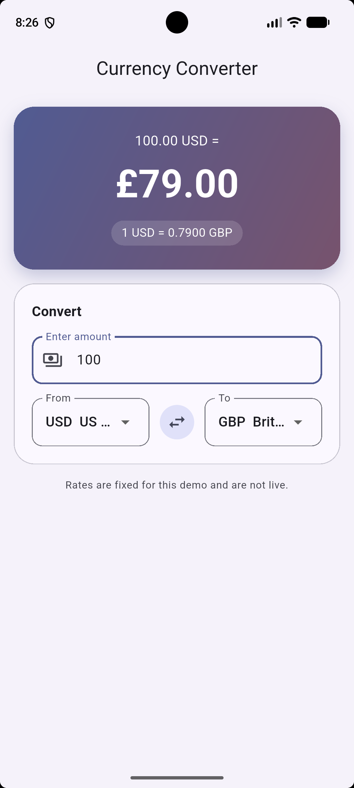

# Currency Converter

A simple Flutter app that converts an amount from one currency to another. It uses a fixed, hard-coded exchange rate table, so it works without the internet.

Built for AE1 Section 3 of LDSCI6206 Fundamentals of Software Engineering.



## Features

- Type an amount and the result updates on every key press. There is no Convert button.
- Pick a From and a To currency from six options: USD, GBP, EUR, JPY, NGN and CAD.
- Swap the two currencies with one tap.
- See the rate being used, for example "1 USD = 0.7900 GBP".
- Big numbers get commas (1,550.00), and Yen is shown with no decimals.

## How to run

1. Install Flutter and set up an Android emulator.
2. Clone this repository and open the `currency_converter` folder.
3. Run `flutter pub get` to get the packages.
4. Run `flutter run` to start the app.
5. Run `flutter test` to run the unit tests.

## Project structure

```
lib/
  main.dart                        App root and the main screen (holds the state)
  data/exchange_rates.dart         Fixed rate table, currency names and symbols
  logic/conversion_calculator.dart Conversion maths and number formatting
  widgets/result_card.dart         Box that shows the result and the rate
  widgets/amount_field.dart        Field for typing the amount
  widgets/currency_selector.dart   Dropdown for picking a currency (used twice)
test/
  conversion_calculator_test.dart  Unit tests for the maths and formatting
```

## How it works

**State.** The main screen is a StatefulWidget. It holds three values: the amount, the From currency and the To currency. Every change calls `setState`, so Flutter rebuilds the screen and the result updates straight away. This is the same approach used in the Fuel Cost Share App labs.

**Keeping logic apart from the UI.** All the maths lives in `ConversionCalculator`, which has no widgets in it. This keeps each file focused on one job and means the maths can be tested on its own.

**Reusable widgets.** `ResultCard`, `AmountField` and `CurrencySelector` are stateless widgets. They do not change anything themselves. Instead, they send changes back to the screen through callbacks (`ValueChanged<String>`), like the `TravellerCounter` widget in the labs. `CurrencySelector` is written once and used twice, for From and To.

## Exchange rates

The rates are fixed for this demo and are not live. Each rate is how much 1 US Dollar is worth.

| Code | Currency | Rate (per 1 USD) |
|------|----------|------------------|
| USD | US Dollar | 1.00 |
| GBP | British Pound | 0.79 |
| EUR | Euro | 0.92 |
| JPY | Japanese Yen | 150.00 |
| NGN | Nigerian Naira | 1550.00 |
| CAD | Canadian Dollar | 1.37 |

To convert between any two currencies, the app divides one rate by the other:

```
rate(from, to) = rate[to] / rate[from]
result = amount × rate(from, to)
```

### Rounding

The maths uses full precision. Only the text on screen is rounded: results to 2 decimal places (0 for Yen), and the rate to 4 decimal places.

This is why 100 GBP to USD shows **126.58** and not 127.00. The exact rate is 1 ÷ 0.79 = 1.2658. The brief's worked example says `~1.27`, where the `~` shows it is approximate. Rounding the rate to 2 decimals first would make small rates very wrong: JPY to USD (0.0067) would become 0.01, a 50% error.

## Input rules and edge cases

| Case | What happens |
|------|--------------|
| Empty field | Treated as 0, so the result shows 0.00 |
| Letters or minus sign | Cannot be typed |
| More than one dot | Cannot be typed |
| More than 2 decimals | Stops at 2 decimals |
| More than 12 digits | Cannot be typed |
| Very big result | Text shrinks to fit the box |
| Same currency on both sides | Rate is 1, and the result equals the amount |

## Testing

`test/conversion_calculator_test.dart` has 8 unit tests. They check:

- The worked examples from the brief: 100 USD → 79.00 GBP and 200 USD → 158.00 GBP.
- The swapped example: 100 GBP → 126.58 USD.
- Edge cases: same currency, zero amount and Yen with no decimals.
- The rate text and the thousand separators.

Run them with `flutter test`.

## Development stages

The app was built in small steps, with one commit for each:

1. Root widget and app bar
2. Exchange rates and conversion logic, with unit tests
3. Result container
4. Amount input with live updates
5. Currency selection and swap
6. Refactor into reusable widgets
7. Styling and input validation
8. Documentation